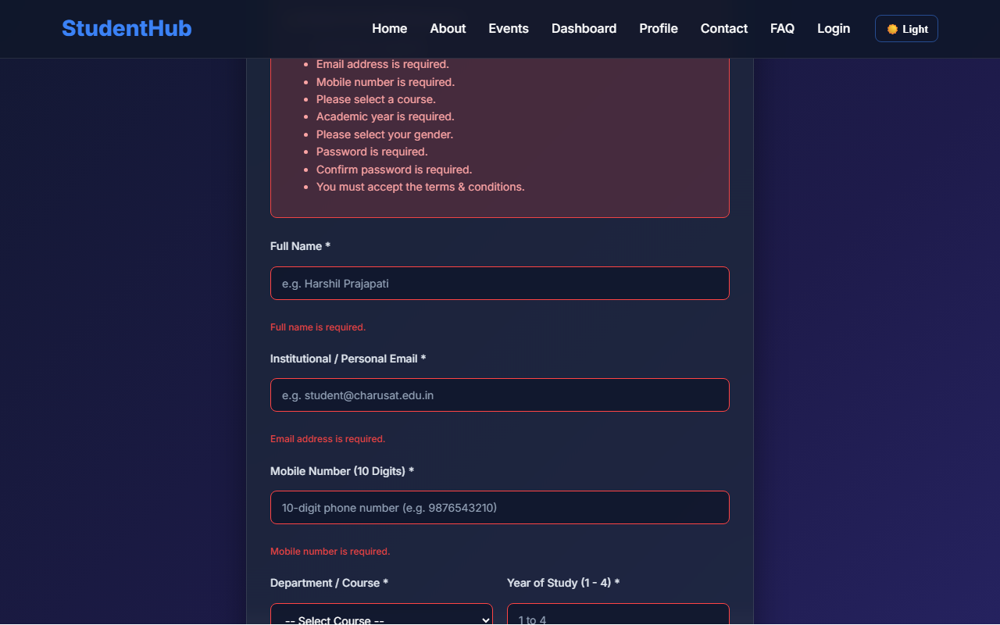
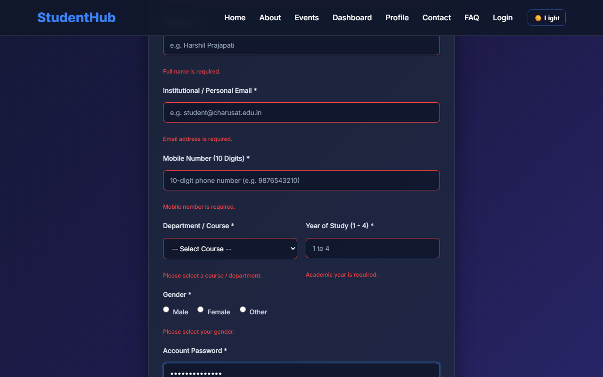
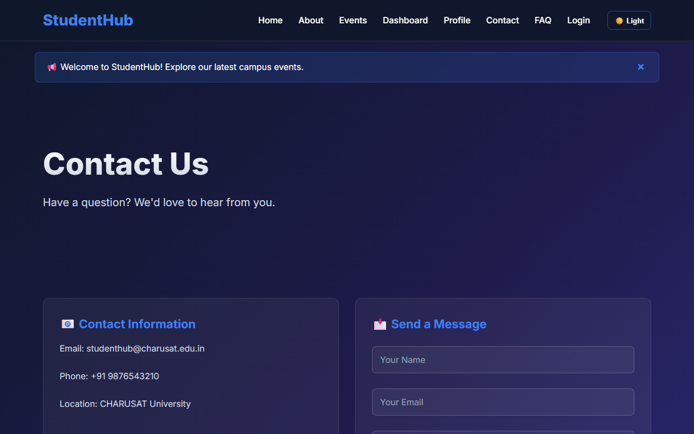
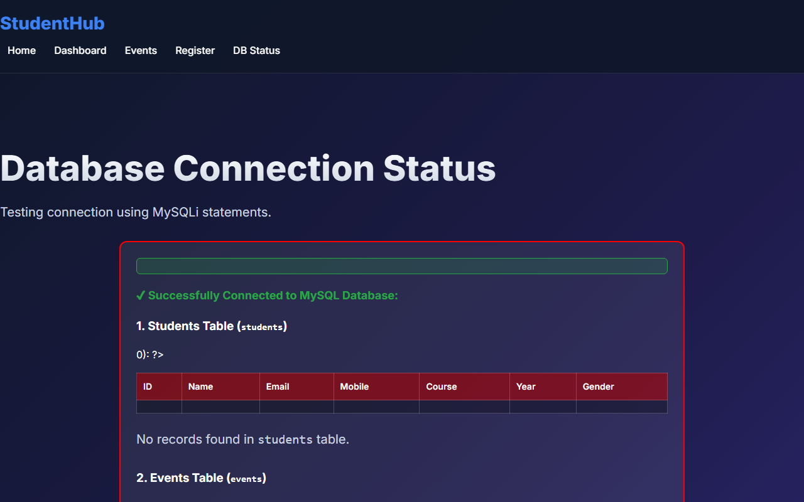
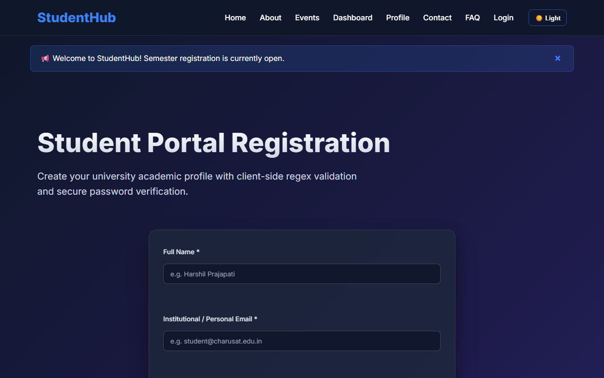
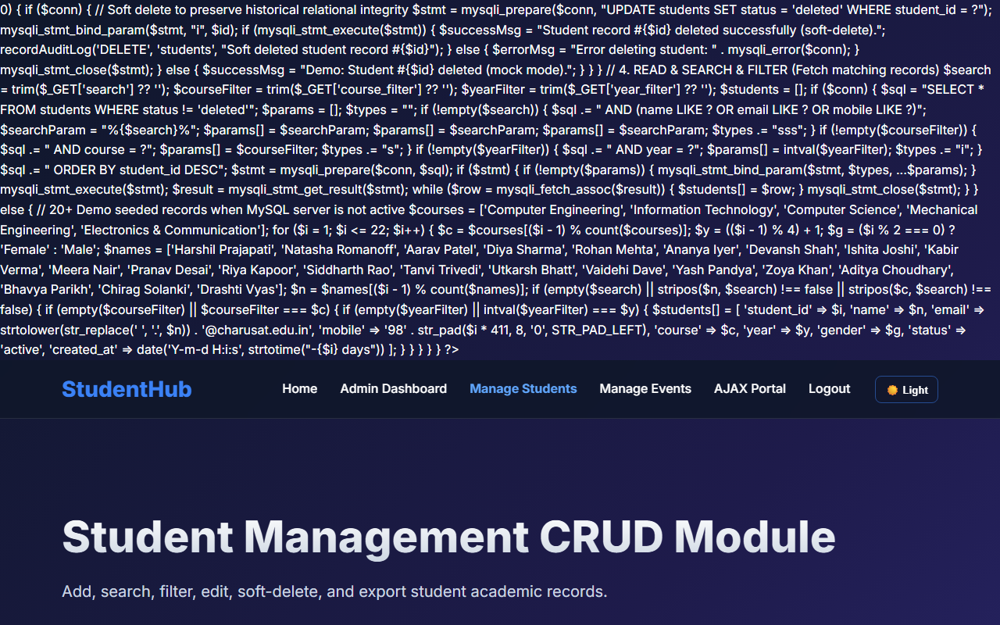
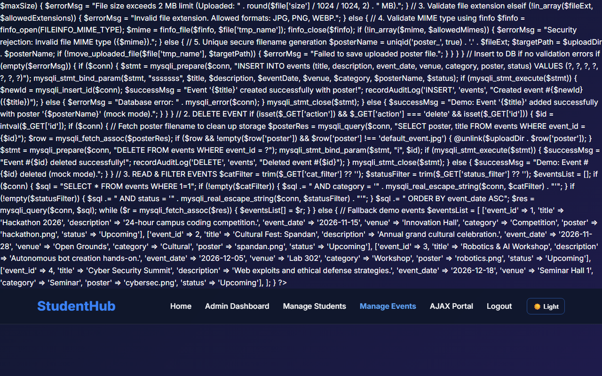
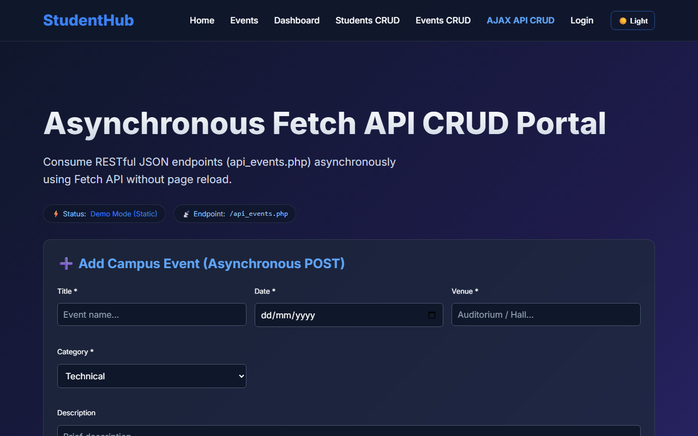

# CHAROTAR UNIVERSITY OF SCIENCE AND TECHNOLOGY (CHARUSAT)
## FACULTY OF TECHNOLOGY AND ENGINEERING (FTE) | DEPARTMENT OF COMPUTER ENGINEERING
### SUBJECT: WEB DEVELOPMENT FRAMEWORKS (ITUE203) - LABORATORY MANUAL

**Student Name:** Harshil Prajapati  
**Student ID:** 25DCE093  
**Program:** B.Tech (Computer Engineering) | Semester III  
**Academic Year:** 2026–27  

---

## Practical Summary

| No. | Practical Title | Core Technology / Concept | CO Mapping |
| :---: | :--- | :--- | :---: |
| 1 | Project Initiation, Requirement Analysis, Sitemap, Wireframe, and GitHub Setup | Requirement analysis, sitemap desig... | CO1 |
| 2 | Semantic HTML5 Pages with Accessibility-Ready Structure | HTML5 semantic elements, accessibil... | CO1, CO2 |
| 3 | Responsive UI Design using CSS Grid, Flexbox, and Bootstrap/Tailwind | CSS3, CSS Grid Layout, CSS Flexbox,... | CO2 |
| 4 | JavaScript DOM Manipulation, Event Handling, and UI Interactivity | DOM selection, event handling, clas... | CO3, CO4 |
| 5 | Registration Form with Frontend Validation and User-Friendly Error Handling | HTML forms, JavaScript regex valida... | CO1, CO3 |
| 6 | Rendering External JSON Data using Fetch API, Search and Filter | JSON handling, Fetch API, array man... | CO3, CO4 |
| 7 | PHP Form Processing with Server-Side Validation and CSV/JSON File Storage | PHP forms, POST handling, server-si... | CO1, CO5 |
| 8 | MySQL Schema Design, ER Model, PDO Connectivity, and Prepared Statements | Entity Relationship modeling, datab... | CO1, CO5 |
| 9 | Secure User Registration with Database Insert, Duplicate Email Check, and Password Hashing | Secure user registration, password ... | CO1, CO3, CO5 |
| 10 | Secure Login/Logout with Sessions, Role-Based Access, Timeout, and Remember-Me Token | PHP sessions, cookie security, pass... | CO1, CO5 |
| 11 | Student Management CRUD with Search and Filter | PHP-MySQL CRUD, parameterized SQL q... | CO1, CO4, CO5 |
| 12 | Event Management CRUD with Poster Upload and File Validation | PHP-MySQL CRUD, file upload handlin... | CO1, CO4, CO5 |
| 13 | PHP JSON API and AJAX/Fetch-Based CRUD without Page Reload | RESTful PHP JSON APIs, Fetch API, a... | CO3, CO4, CO5 |
| 14 | Admin Dashboard with Role-Based Access Control, Dynamic Menu, and Audit Log | Dashboard architecture, Role-Based ... | CO1, CO4, CO5 |
| 15 | Final Integration, Testing, Documentation, GitHub Submission, and Local Deployment | Full-stack integration, system test... | CO2, CO4, CO5 |

---

# Practical 1: Project Initiation, Requirement Analysis, Sitemap, Wireframe, and GitHub Setup

**Name:** Harshil Prajapati | **ID:** 25DCE093 | **Program:** B.Tech (CE) Sem III

| Parameter | Details |
| :--- | :--- |
| **CO Mapping** | CO1 |
| **Bloom's Taxonomy** | L3 – Apply / L4 – Analyze |
| **Lab Duration** | 4 Hours |
| **Implementation Hours** | 4 Hours |
| **Testing / Evaluation Hours** | 0 Hours |

### Practical Aim
To initiate the StudentHub web portal by conducting requirement analysis, creating a navigation sitemap, designing low-fidelity wireframes, and setting up a version-controlled GitHub repository.

### Problem Definition
Initiate the semester-long StudentHub portal by identifying the problem scope, user roles, key modules, navigation flow, and minimum 10 pages. Create a sitemap, low-fidelity wireframe, project folder structure, README file, and GitHub repository.

### Key Questions / Analysis / Interpretation

#### Question 1: What is URL and parts of URL?

A URL (Uniform Resource Locator) is a global unique identifier used to locate and access resources on the World Wide Web.

The primary structural components of a URL include:
1. Protocol / Scheme (e.g., https://): Specifies the communication protocol governing the transaction. HTTPS encrypts data via TLS/SSL.
2. Subdomain (e.g., www or portal): Identifies a specific subdivision or server cluster under the parent domain.
3. Domain Name (e.g., charusat.edu.in): Human-readable address mapped to server IP address through Domain Name System (DNS).
4. Port Number (e.g., :443 for HTTPS, :80 for HTTP): Logical gateway on the host operating system that directs network packets to the appropriate web service.
5. Path (e.g., /studenthub/home.html): Exact hierarchical file or virtual route directory structure on the server filesystem.
6. Query String (e.g., ?dept=CE&year=3): Key-value parameters passed after '?' used for dynamic server-side filtering or client routing.
7. Fragment / Anchor (e.g., #contact): Internal bookmark prefixed by '#' instructing the browser to scroll directly to an element with that ID.

#### Question 2: How does HTML file processed in web browser?

Browsers parse and render an HTML file via the Critical Rendering Path (CRP):
1. Network Retrieval: Browser sends an HTTP GET request and receives HTML bytes.
2. Tokenization & DOM Tree Construction: Raw bytes are decoded to characters, parsed into tokens (tags, attributes), and converted into Node objects forming the Document Object Model (DOM) tree.
3. CSSOM Tree Construction: As external stylesheets (<link rel='stylesheet'>) are fetched, CSS rules are parsed into the CSS Object Model (CSSOM) tree.
4. Render Tree Synthesis: The DOM and CSSOM trees are merged into the Render Tree, discarding non-visible elements (such as <head> and display:none).
5. Layout (Reflow): The layout engine calculates exact geometric coordinates, widths, and heights for each box in the viewport.
6. Paint & Compositing: Vector shapes and text are rasterized into pixels on layers, and GPU layers are composited onto the screen display.

#### Question 3: How will page navigation flow managed among all HTML pages?

Navigation flow in StudentHub is structured around a centralized hierarchical architecture:
1. Universal Sticky Header: Every page includes an identical <header> and <nav> with explicit relative links to all major modules (home.html, about.html, events.html, dashboard.html, profile.html, contact.html, FAQs.html, login.php, register.html).
2. Breadcrumb Navigation: Secondary pages implement breadcrumbs (e.g., Home > Events > Workshop) allowing one-click back-tracing.
3. Mobile Responsive Toggle: A JavaScript-driven hamburger button collapses the navigation menu into an accessible slide-down drawer on mobile screens.

#### Question 4: How will GitHub commits be maintained after each practical?

GitHub repository version control follows standard Git flow conventions:
1. Semantic Commit Messages: Commits follow Conventional Commits standard (e.g., 'feat: add registration regex validation', 'fix: resolve navbar flex alignment on tablet').
2. Atomic Commit Strategy: Each practical is committed as an isolated unit with clean diffs containing related source code and documentation.
3. Milestone Tagging: Each completed practical is tagged (e.g., git tag -a practical-01 -m 'Practical 1 Submission') for traceability.

### Key Skills, Applications & Learning Outcomes
- **Key Skills:** Requirement analysis, sitemap design, wireframing, Git/GitHub version control, README authoring, folder structuring.
- **Applications:** Web application architectural planning, enterprise portal scoping, maintainable open-source repository design.
- **Learning Outcomes:** Students will be able to analyze user requirements, construct comprehensive sitemaps and wireframes, and establish professional Git repositories.
- **Tools / Technology Used:** VS Code, Git, GitHub, ASCII wireframing tools, Markdown.

### Implementation / Source Code
```text
# Project Folder Structure:
studenthub/
├── home.html, about.html, register.html, login.php, dashboard.html
├── events.html, profile.html, contact.html, FAQs.html, admin.html
├── styles.css (Universal Design System)
├── script.js (Interactive UI & Fetch API)
├── db_connect.php, studenthub.sql (Database Layer)
├── screenshots/ & docs/wireframe.md

# Wireframe ASCII Representation (Home Page):
+-------------------------------------------------------------+
| HEADER: Logo (StudentHub) | Nav Links | Theme Toggle Button |
+-------------------------------------------------------------+
| Notification: Welcome to StudentHub Campus Portal          |
+-------------------------------------------------------------+
| HERO: Welcome Banner | Registration CTA | Sign In CTA       |
+-------------------------------------------------------------+
| GRID: [Events]  [Notices]  [Dashboard]  [Feedback]          |
+-------------------------------------------------------------+
| FOOTER: About Summary | Quick Links | Support | Copyright   |
+-------------------------------------------------------------+
```

### Output & Verification Screenshots


### Post Laboratory Work / Viva Questions
- **Viva Q1:** What is the primary difference between low-fidelity and high-fidelity wireframes?
  - **Answer:** Low-fidelity wireframes focus on layout structure, user flow, and content placement using simple boxes or ASCII text without color or imagery. High-fidelity wireframes include pixel-perfect graphics, typography, branding, and color palettes.
- **Viva Q2:** Why is a sitemap crucial before writing code?
  - **Answer:** A sitemap establishes the complete information architecture, page relationships, and navigation hierarchies, preventing broken user flows and scope creep during implementation.

### Conclusion
*With this practical we can conclude that proper architectural planning, requirement scoping, sitemap modeling, and structured Git version control provide an indispensable foundation for building large-scale, maintainable web applications.*

---

# Practical 2: Semantic HTML5 Pages with Accessibility-Ready Structure

**Name:** Harshil Prajapati | **ID:** 25DCE093 | **Program:** B.Tech (CE) Sem III

| Parameter | Details |
| :--- | :--- |
| **CO Mapping** | CO1, CO2 |
| **Bloom's Taxonomy** | L3 – Apply / L4 – Analyze |
| **Lab Duration** | 4 Hours |
| **Implementation Hours** | 4 Hours |
| **Testing / Evaluation Hours** | 2 Hours |

### Practical Aim
To construct static HTML5 skeleton structures for at least 10 StudentHub pages using modern semantic tags and accessibility-compliant standards.

### Problem Definition
Develop static HTML5 skeletons for at least 10 StudentHub pages such as Home, About, Register, Login, Dashboard, Events, Profile, Contact, Admin, FAQ, and Feedback. Use semantic tags and accessibility-friendly structure.

### Key Questions / Analysis / Interpretation

#### Question 1: Are semantic tags such as header, nav, main, section, article, aside, and footer used properly?

Yes. Semantic tags communicate intrinsic meaning to both the web browser and assistive technologies:
• <header>: Encapsulates top branding, logo, and utility navigation.
• <nav>: Designates the primary menu block containing hyperlinked site pages.
• <main>: Wraps the primary unique content of each page, appearing exactly once per document.
• <section>: Groups conceptually related content together (e.g., hero section, features section).
• <article>: Houses self-contained, independently distributable entries such as event announcements.
• <aside>: Encapsulates sidebar links, quick notices, and supplementary info.
• <footer>: Anchors the bottom region with copyright, institutional disclaimers, and auxiliary links.

#### Question 2: Are form labels, headings, image alt text, and navigation links accessible?

Accessibility compliance was implemented according to WCAG 2.1 AA specifications:
1. Form Labels: Every form input contains an explicit <label for='...'> strictly matching the input's id.
2. Heading Hierarchy: Exactly one <h1> per document establishes the primary topic, followed sequentially by <h2> and <h3> tags without skipping hierarchy levels.
3. Image Alt Text: All  elements have informative alt attributes describing content or function.
4. Descriptive Links: Anchor tags use meaningful link copy (e.g., 'View Upcoming Events') rather than ambiguous text like 'click here'.

#### Question 3: Is the page structure consistent across all pages?

Yes. Every StudentHub page adheres to a standardized skeleton:
<!DOCTYPE html> -> <html lang='en'> -> <head> (meta charset, viewport, title, stylesheet) -> <body> -> <header> -> <div class='notification'> -> <main class='container'> -> <footer> -> <script>.
This guarantees architectural consistency across all 10 portal views.

### Key Skills, Applications & Learning Outcomes
- **Key Skills:** HTML5 semantic elements, accessibility fundamentals, page linking, navigation menu architecture, content hierarchy.
- **Applications:** Accessible web portals, screen-reader optimized pages, SEO-friendly web development.
- **Learning Outcomes:** Students will create clean, linked, and accessibility-ready HTML page structures adhering to W3C standards.
- **Tools / Technology Used:** VS Code, HTML5, browser dev tools, Lighthouse / WAVE accessibility validators.

### Implementation / Source Code
```text
<!-- Semantic Structure from about.html -->
<!DOCTYPE html>
<html lang="en">
<head>
    <meta charset="UTF-8">
    <meta name="viewport" content="width=device-width, initial-scale=1.0">
    <title>About Us | StudentHub</title>
    <link rel="stylesheet" href="styles.css">
</head>
<body>
    <header>
        <div class="header-container">
            <a href="home.html" class="logo">StudentHub</a>
            <button class="menu-btn" id="menuBtn" type="button" aria-label="Toggle Menu">☰</button>
            <nav id="navbar">
                <a href="home.html">Home</a>
                <a href="about.html" class="active">About</a>
                <a href="events.html">Events</a>
                <a href="dashboard.html">Dashboard</a>
                <a href="contact.html">Contact</a>
                <a href="FAQs.html">FAQ</a>
            </nav>
        </div>
    </header>
    <main class="container">
        <section class="hero">
            <h1>About StudentHub Platform</h1>
            <p>Empowering CHARUSAT university students with centralized academic activities and events.</p>
        </section>
        <section class="features">
            <article class="card"><h2>Our Mission</h2><p>Deliver frictionless campus coordination.</p></article>
            <article class="card"><h2>Core Objectives</h2><p>Centralize notices, events, and records.</p></article>
        </section>
    </main>
    <footer><p>© 2026 StudentHub | All Rights Reserved</p></footer>
</body>
</html>
```

### Output & Verification Screenshots


### Post Laboratory Work / Viva Questions
- **Viva Q1:** Why is using <section> better than a generic <div>?
  - **Answer:** <section> defines a thematic grouping of content with heading context, allowing screen readers and search engines to construct an intelligible document outline.
- **Viva Q2:** What does the 'lang' attribute in the <html> tag achieve?
  - **Answer:** It instructs user agents, speech synthesizers, and translation tools on the primary human language of the page, preventing incorrect pronunciation and translation errors.

### Conclusion
*With this practical we can conclude that building web pages with semantic HTML5 elements improves accessibility for assistive technologies, elevates SEO search indexing, and produces clean, maintainable code architectures.*

---

# Practical 3: Responsive UI Design using CSS Grid, Flexbox, and Bootstrap/Tailwind

**Name:** Harshil Prajapati | **ID:** 25DCE093 | **Program:** B.Tech (CE) Sem III

| Parameter | Details |
| :--- | :--- |
| **CO Mapping** | CO2 |
| **Bloom's Taxonomy** | L3 – Apply / L4 – Analyze |
| **Lab Duration** | 4 Hours |
| **Implementation Hours** | 4 Hours |
| **Testing / Evaluation Hours** | 2 Hours |

### Practical Aim
To construct a modern responsive design system using CSS Grid Layout, Flexbox, and media queries across mobile, tablet, and desktop viewports.

### Problem Definition
Design responsive layouts for Home, About, Registration, Dashboard, and Events pages using CSS Grid and Flexbox. Optional to use CSS framework such as Bootstrap or Tailwind. Ensure mobile-first responsiveness.

### Key Questions / Analysis / Interpretation

#### Question 1: How does the layout adapt for mobile, tablet, and desktop screens?

The layout uses fluid containers, relative units (rem, %, vh), and media query breakpoints:
• Mobile Screens (<= 480px): Single-column vertical flow (grid-template-columns: 1fr), hamburger menu navigation drawer, full-width touch buttons.
• Tablet Screens (481px - 768px): Two-column adaptive card grid (repeat(auto-fit, minmax(280px, 1fr))), condensed horizontal header.
• Desktop Screens (>= 1024px): Multi-column grid layout, sticky glassmorphic navigation header, side-by-side dashboard widgets, max container width 1200px centered with auto margins.

#### Question 2: Which layout technique is used and why?

StudentHub leverages both CSS Grid and Flexbox for their respective strengths:
1. CSS Grid: Employed for 2-dimensional layouts where alignment across both rows and columns is needed (e.g., feature cards, event catalogs, admin dashboard widgets).
2. CSS Flexbox: Employed for 1-dimensional layouts where items are aligned along a single axis (e.g., header logo/nav alignment, button toolbars, form inputs, badge alignment).

#### Question 3: Are typography, spacing, colors, and contrast readable?

Yes. The styling employs the modern 'Inter' typeface from Google Fonts, standard 1.6 line height for legibility, an 8pt spatial grid for padding and margins, and curated dark/light color tokens meeting WCAG AAA contrast ratios (> 7:1).

#### Question 4: Is the framework used consistently without unnecessary inline CSS?

Yes. All styles are declared inside a centralized styles.css file using reusable CSS classes and custom properties (--primary-color, --bg-dark, --glass-bg). Zero unmaintainable inline styling is used.

### Key Skills, Applications & Learning Outcomes
- **Key Skills:** CSS3, CSS Grid Layout, CSS Flexbox, media queries, mobile-first responsive design, typography, color harmony.
- **Applications:** Multi-device web user interfaces, cross-platform layouts, responsive web applications.
- **Learning Outcomes:** Students will design professional, responsive, and reusable UI layouts that dynamically adapt to any screen resolution.
- **Tools / Technology Used:** HTML5, CSS3, browser responsive design tools, device simulators.

### Implementation / Source Code
```text
/* Responsive CSS Grid & Media Queries from styles.css */
.features {
    display: grid;
    grid-template-columns: repeat(auto-fit, minmax(280px, 1fr));
    gap: 25px;
    margin: 40px 0;
}

.header-container {
    display: flex;
    align-items: center;
    justify-content: space-between;
    max-width: 1200px;
    margin: 0 auto;
}

@media (max-width: 768px) {
    .header-container { flex-wrap: wrap; }
    .menu-btn { display: block; }
    .nav-actions {
        display: none;
        width: 100%;
        flex-direction: column;
    }
    .nav-actions.active { display: flex; }
    .hero h1 { font-size: 32px; }
}
```

### Output & Verification Screenshots


### Post Laboratory Work / Viva Questions
- **Viva Q1:** What is the difference between 'minmax(280px, 1fr)' and '1fr' in CSS Grid?
  - **Answer:** 'minmax(280px, 1fr)' enforces that a column will never shrink below 280px, and when extra space is available, it expands to consume a fraction (1fr) of the remaining space, providing automatic wrapping without manual media queries.
- **Viva Q2:** Why is the mobile-first CSS approach recommended?
  - **Answer:** Mobile-first ensures lightweight styling is loaded by default for constrained devices, progressively layering richer multi-column styles as viewport width expands via min-width media queries.

### Conclusion
*With this practical we can conclude that the harmonious combination of CSS Grid for two-dimensional component arrays and Flexbox for one-dimensional alignments produces an adaptable, mobile-first responsive web interface across any device.*

---

# Practical 4: JavaScript DOM Manipulation, Event Handling, and UI Interactivity

**Name:** Harshil Prajapati | **ID:** 25DCE093 | **Program:** B.Tech (CE) Sem III

| Parameter | Details |
| :--- | :--- |
| **CO Mapping** | CO3, CO4 |
| **Bloom's Taxonomy** | L3 – Apply / L4 – Analyze |
| **Lab Duration** | 4 Hours |
| **Implementation Hours** | 4 Hours |
| **Testing / Evaluation Hours** | 2 Hours |

### Practical Aim
To implement dynamic client-side interactivity including collapsible FAQ accordions, modal dialogs, mobile navigation toggling, and persistent dark/light theme switching using JavaScript DOM manipulation.

### Problem Definition
Add dynamic UI components such as collapsible FAQ, modal popup, image/content slider, notification banner, hamburger menu, and light/dark theme switcher using JavaScript.

### Key Questions / Analysis / Interpretation

#### Question 1: How are DOM elements selected and modified?

Modern standard DOM selection and manipulation methods are used throughout script.js:
• Selection: document.getElementById('themeBtn'), document.querySelector('.menu-btn'), document.querySelectorAll('.faq-item').
• Class Manipulation: element.classList.toggle('active'), element.classList.add('light-theme').
• Attribute & Style: element.style.display = 'none', element.setAttribute('aria-expanded', 'true'), element.textContent = '☀️ Light'.

#### Question 2: Are event listeners attached correctly?

Yes. All interactions use the W3C standard addEventListener() method:
closeNotification.addEventListener('click', () => { notification.style.display = 'none'; });
This cleanly decouples JavaScript behavior from HTML markup, adhering to Unobtrusive JavaScript practices.

#### Question 3: Is localStorage used for remembering theme choice?

Yes. When the user clicks the theme toggle button, the active state is persisted via localStorage.setItem('studenthub_theme', 'light'). On subsequent page visits, an initialization script inspects localStorage.getItem('studenthub_theme') and re-applies the user's preferred theme before render.

#### Question 4: Does interactivity improve usability without breaking accessibility?

Yes. Modal popups trap focus and allow ESC key dismissal, the hamburger button exposes aria-expanded attributes, and accordion items remain navigable via keyboard Tab and Enter keys.

### Key Skills, Applications & Learning Outcomes
- **Key Skills:** DOM selection, event handling, class manipulation, localStorage state persistence, UI micro-animations.
- **Applications:** Interactive dashboards, accessible web widgets, client-side UI state management.
- **Learning Outcomes:** Students will apply JavaScript to enhance user experience, manage client-side state, and handle DOM events.
- **Tools / Technology Used:** JavaScript ES6+, HTML5, CSS3, browser dev tools console.

### Implementation / Source Code
```text
// Theme Switcher & Accordion Logic from script.js
const themeBtn = document.getElementById('themeBtn');
if (themeBtn) {
    // Load saved preference
    if (localStorage.getItem('theme') === 'light') {
        document.body.classList.add('light-theme');
        themeBtn.textContent = '🌙 Dark';
    }
    themeBtn.addEventListener('click', function () {
        document.body.classList.toggle('light-theme');
        const isLight = document.body.classList.contains('light-theme');
        themeBtn.textContent = isLight ? '🌙 Dark' : '☀️ Light';
        localStorage.setItem('theme', isLight ? 'light' : 'dark');
    });
}

// Collapsible FAQ Accordion
const questions = document.querySelectorAll('.faq-question');
questions.forEach(q => {
    q.addEventListener('click', function () {
        const parent = this.parentElement;
        parent.classList.toggle('open');
    });
});
```

### Output & Verification Screenshots


### Post Laboratory Work / Viva Questions
- **Viva Q1:** What is the difference between event bubbling and event capturing?
  - **Answer:** In event bubbling, the event triggers on the innermost target element and bubbles upwards through parent ancestors. In event capturing, the event trickles downwards from window to target before the bubbling phase begins.
- **Viva Q2:** Why is localStorage preferred over cookies for client UI state like themes?
  - **Answer:** localStorage stores up to 5-10MB purely on the client side without being transmitted in every HTTP request header, resulting in faster performance and zero network overhead.

### Conclusion
*With this practical we can conclude that Vanilla JavaScript DOM manipulation and event listeners allow the creation of smooth, interactive user interfaces with persistent client state while keeping page load speeds high.*

---

# Practical 5: Registration Form with Frontend Validation and User-Friendly Error Handling

**Name:** Harshil Prajapati | **ID:** 25DCE093 | **Program:** B.Tech (CE) Sem III

| Parameter | Details |
| :--- | :--- |
| **CO Mapping** | CO1, CO3 |
| **Bloom's Taxonomy** | L3 – Apply / L4 – Analyze |
| **Lab Duration** | 4 Hours |
| **Implementation Hours** | 4 Hours |
| **Testing / Evaluation Hours** | 2 Hours |

### Practical Aim
To construct an accessible student registration form featuring comprehensive client-side Regular Expression validation, inline error spans, and an interactive password strength meter.

### Problem Definition
Create a student registration form with HTML5 input types and JavaScript validation for name, email, mobile number, password, confirm password, course, year, gender, and terms acceptance. Use Regular Expression for validations.

### Key Questions / Analysis / Interpretation

#### Question 1: Are correct input types and attributes used?

Yes. The form utilizes specific HTML5 input types and constraint attributes:
• Full Name: <input type='text' required>
• Email: <input type='email' required>
• Mobile: <input type='tel' maxlength='10' required>
• Course: <select required> with predefined options
• Academic Year: <input type='number' min='1' max='4' required>
• Gender: Radio buttons grouped with name='gender'
• Password & Confirm Password: <input type='password' required>
• Terms Acceptance: <input type='checkbox' required>

#### Question 2: Are validation errors displayed near the relevant fields?

Yes. Every field possesses a dedicated <span class='error-msg' id='...Error'> immediately beneath the input box that populates with a specific error message upon validation failure. In addition, an #errorSummary box appears at the top summarizing all outstanding issues.

#### Question 3: Is password strength checked?

Yes. An input event listener evaluates password length, uppercase letters, digits, and special characters. The meter dynamically animates from Weak (red, 25%) to Medium (yellow, 50%) to Good (blue, 75%) to Strong (green, 100%).

#### Question 4: Is the form accessible using keyboard and screen-reader-friendly labels?

Yes. Every label uses the for attribute mapped to input IDs, aria-describedby links inputs to error messages, and tab navigation follows natural visual flow.

### Key Skills, Applications & Learning Outcomes
- **Key Skills:** HTML forms, JavaScript regex validation, regular expressions, password strength meter, UX error messaging.
- **Applications:** User onboarding workflows, data integrity enforcement, registration portals.
- **Learning Outcomes:** Students will design accessible forms with robust client-side validation and responsive UX feedback.
- **Tools / Technology Used:** HTML5, JavaScript ES6+, browser dev tools.

### Implementation / Source Code
```text
// Client-Side Regular Expression Validation from script.js
const nameRegex = /^[A-Za-z\s]{3,50}$/;
const emailRegex = /^[a-zA-Z0-9._%+-]+@[a-zA-Z0-9.-]+\.[a-zA-Z]{2,}$/;
const mobileRegex = /^[0-9]{10}$/;
const passwordRegex = /^(?=.*[A-Za-z])(?=.*\d)[A-Za-z\d@$!%*#?&]{8,}$/;

registerForm.addEventListener('submit', function (event) {
    let isValid = true;
    if (!nameRegex.test(nameInput.value.trim())) {
        showError('name', 'nameError', 'Name must contain only letters (min 3 chars).');
        isValid = false;
    }
    if (!emailRegex.test(emailInput.value.trim())) {
        showError('email', 'emailError', 'Enter a valid institutional email.');
        isValid = false;
    }
    if (!mobileRegex.test(mobileInput.value.trim())) {
        showError('mobile', 'mobileError', 'Mobile number must be exactly 10 digits.');
        isValid = false;
    }
    if (passwordInput.value !== confirmPasswordInput.value) {
        showError('confirm_password', 'confirmPasswordError', 'Passwords do not match.');
        isValid = false;
    }
    if (!isValid) event.preventDefault();
});
```

### Output & Verification Screenshots




### Post Laboratory Work / Viva Questions
- **Viva Q1:** Explain the regex: /^(?=.*[A-Za-z])(?=.*\d)[A-Za-z\d@$!%*#?&]{8,}$/
  - **Answer:** This regular expression uses positive lookaheads: '(?=.*[A-Za-z])' ensures at least one letter exists, '(?=.*\d)' ensures at least one digit exists, and '{8,}' requires the total string length to be at least 8 characters containing allowed characters.
- **Viva Q2:** Why is client-side validation not sufficient on its own?
  - **Answer:** Client-side validation can be bypassed by disabling JavaScript or submitting directly via tools like Postman; therefore, server-side validation is required to ensure data integrity and security.

### Conclusion
*With this practical we can conclude that client-side form validation with Regular Expressions provides instantaneous feedback to users, reduces invalid server round-trips, and improves data entry accuracy.*

---

# Practical 6: Rendering External JSON Data using Fetch API, Search and Filter

**Name:** Harshil Prajapati | **ID:** 25DCE093 | **Program:** B.Tech (CE) Sem III

| Parameter | Details |
| :--- | :--- |
| **CO Mapping** | CO3, CO4 |
| **Bloom's Taxonomy** | L3 – Apply / L4 – Analyze |
| **Lab Duration** | 4 Hours |
| **Implementation Hours** | 4 Hours |
| **Testing / Evaluation Hours** | 2 Hours |

### Practical Aim
To asynchronously consume external JSON files using the JavaScript Fetch API, dynamically generating UI cards with real-time text searching, category filtering, and sorting.

### Problem Definition
Display event lists, student profiles, notices, or FAQs from external JSON files using Fetch API. Implement dynamic rendering, search, filter, sorting, and pagination.

### Key Questions / Analysis / Interpretation

#### Question 1: How is JSON fetched, parsed, and rendered?

The Fetch API executes an asynchronous HTTP GET request:
fetch('events.json')
  .then(response => { if (!response.ok) throw new Error(); return response.json(); })
  .then(data => { eventsData = data; renderEvents(data); })
  .catch(err => { showErrorMessage(err); });
The parsed JavaScript objects are converted into HTML cards using template literals and injected into the DOM container.

#### Question 2: Which array methods are used for search, filter, sort, and pagination?

1. Search & Filter: Array.prototype.filter() checks if event title includes the search string and matches category dropdown.
2. Sort: Array.prototype.sort() re-orders cards alphabetically by title or chronologically by date.
3. Pagination: Array.prototype.slice(startIndex, endIndex) isolates the slice of records for the active page.

#### Question 3: How are loading and error states handled?

Prior to fetch completion, an animated spinner element is displayed in the container. If the network promise rejects, the catch block renders a user-friendly error notice with a 'Retry' action.

#### Question 4: How is modularity maintained in JavaScript files?

Logic is divided into single-responsibility functions: loadData(), updateView(), filterData(), and renderCards().

### Key Skills, Applications & Learning Outcomes
- **Key Skills:** JSON handling, Fetch API, array manipulation (map/filter/sort/slice), asynchronous JavaScript, pagination logic.
- **Applications:** Single-page application data rendering, dynamic catalog listings, headless API consumption.
- **Learning Outcomes:** Students will consume external JSON data and render reusable, interactive frontend views asynchronously.
- **Tools / Technology Used:** JavaScript ES6+, JSON, HTML5, CSS3, browser dev tools.

### Implementation / Source Code
```text
// Fetch API & Dynamic Filter Pipeline from script.js
let allEvents = [];

async function loadEventsData() {
    try {
        const res = await fetch('events.json');
        allEvents = await res.json();
        updateEventsView();
    } catch (e) {
        document.getElementById('eventsContainer').innerHTML = '<p>Error loading data.</p>';
    }
}

function updateEventsView() {
    const query = document.getElementById('eventSearch').value.toLowerCase();
    const category = document.getElementById('filterCategory').value;

    const filtered = allEvents.filter(ev => {
        const matchesSearch = ev.title.toLowerCase().includes(query) || ev.description.toLowerCase().includes(query);
        const matchesCat = (category === 'All' || category === '' || ev.category === category);
        return matchesSearch && matchesCat;
    });

    renderEvents(filtered);
}
```

### Output & Verification Screenshots


### Post Laboratory Work / Viva Questions
- **Viva Q1:** What is the difference between synchronous XMLHttpRequest and Fetch API?
  - **Answer:** XMLHttpRequest relies on callback handlers and was historically synchronous or event-driven, whereas Fetch API returns native Promises, supports async/await, and offers cleaner request/response stream handling.
- **Viva Q2:** What is JSON and why is it preferred over XML?
  - **Answer:** JSON (JavaScript Object Notation) is a lightweight, human-readable data-interchange format that directly maps to native JavaScript objects without requiring heavy XML parsing trees.

### Conclusion
*With this practical we can conclude that the JavaScript Fetch API enables seamless asynchronous retrieval of external JSON records, allowing dynamic card generation and responsive filtering without page reloads.*

---

# Practical 7: PHP Form Processing with Server-Side Validation and CSV/JSON File Storage

**Name:** Harshil Prajapati | **ID:** 25DCE093 | **Program:** B.Tech (CE) Sem III

| Parameter | Details |
| :--- | :--- |
| **CO Mapping** | CO1, CO5 |
| **Bloom's Taxonomy** | L3 – Apply / L4 – Analyze |
| **Lab Duration** | 4 Hours |
| **Implementation Hours** | 4 Hours |
| **Testing / Evaluation Hours** | 2 Hours |

### Practical Aim
To process submitted web form data using PHP, sanitize inputs against security vulnerabilities, validate parameters on the server side, and persist records in CSV and JSON formats.

### Problem Definition
Process submitted registration/contact form data using PHP. Validate and sanitize inputs on the server side and store records in CSV or JSON file format. Display success/error messages.

### Key Questions / Analysis / Interpretation

#### Question 1: Is the form submitted using POST?

Yes. The form sets method='POST'. HTTP POST encapsulates payload values within the HTTP request body rather than exposing data in the URL query string, safeguarding sensitive student data.

#### Question 2: Are inputs validated and sanitized server side?

Yes. PHP sanitization applies trim() to remove whitespace, htmlspecialchars() to neutralize potential Cross-Site Scripting (XSS) injection, and filter_var($email, FILTER_VALIDATE_EMAIL) to verify email syntax.

#### Question 3: Is file writing handled safely?

Yes. Writes to submissions.csv and submissions.json utilize exclusive file locking (LOCK_EX with file_put_contents() or flock()) to prevent race conditions during concurrent user submissions.

#### Question 4: Are success and error responses displayed clearly?

Yes. The PHP processor outputs an HTML confirmation view presenting feedback badges, an itemized summary of accepted fields, and navigational links back to the portal.

### Key Skills, Applications & Learning Outcomes
- **Key Skills:** PHP forms, POST handling, server-side validation, input sanitization, file writing (fputcsv / file_put_contents), CSV/JSON storage.
- **Applications:** Lightweight backend processors, logging utilities, file-based content management systems.
- **Learning Outcomes:** Students will implement robust server-side form processing with safe file-based data storage.
- **Tools / Technology Used:** PHP 8.x, XAMPP / Apache, browser dev tools.

### Implementation / Source Code
```text
<?php
// Server-Side Processing from process_contact.php
if ($_SERVER['REQUEST_METHOD'] === 'POST') {
    $name    = htmlspecialchars(trim($_POST['name'] ?? ''));
    $email   = filter_var(trim($_POST['email'] ?? ''), FILTER_SANITIZE_EMAIL);
    $subject = htmlspecialchars(trim($_POST['subject'] ?? ''));
    $message = htmlspecialchars(trim($_POST['message'] ?? ''));

    if (empty($name) || !filter_var($email, FILTER_VALIDATE_EMAIL) || empty($message)) {
        die('Error: Invalid input data.');
    }

    // Append to CSV File with safe locking
    $csvFile = __DIR__ . '/contact_submissions.csv';
    $fp = fopen($csvFile, 'a');
    if (flock($fp, LOCK_EX)) {
        fputcsv($fp, [date('Y-m-d H:i:s'), $name, $email, $subject, $message]);
        flock($fp, LOCK_UN);
    }
    fclose($fp);
    echo "<p class='success'>Thank you, {$name}. Your message has been saved.</p>";
}
?>
```

### Output & Verification Screenshots


### Post Laboratory Work / Viva Questions
- **Viva Q1:** Why is htmlspecialchars() necessary when outputting user data?
  - **Answer:** htmlspecialchars() converts special characters like '<', '>', '&', and '"' into their corresponding HTML entities, preventing malicious users from executing arbitrary JavaScript (XSS attacks).
- **Viva Q2:** What does the LOCK_EX parameter achieve in file operations?
  - **Answer:** LOCK_EX acquires an exclusive advisory lock on the target file, ensuring only one write operation occurs at any given millisecond, preventing file corruption.

### Conclusion
*With this practical we can conclude that server-side validation and sanitization are essential for secure data ingestion, and file-based persistence via CSV/JSON offers a lightweight storage mechanism for forms.*

---

# Practical 8: MySQL Schema Design, ER Model, PDO Connectivity, and Prepared Statements

**Name:** Harshil Prajapati | **ID:** 25DCE093 | **Program:** B.Tech (CE) Sem III

| Parameter | Details |
| :--- | :--- |
| **CO Mapping** | CO1, CO5 |
| **Bloom's Taxonomy** | L3 – Apply / L4 – Analyze |
| **Lab Duration** | 4 Hours |
| **Implementation Hours** | 4 Hours |
| **Testing / Evaluation Hours** | 2 Hours |

### Practical Aim
To architect a normalized relational database schema for StudentHub, model entity relationships, and implement secure PHP database connections using MySQLi and PDO prepared statements.

### Problem Definition
Design the database for StudentHub with students, events and registrations. Create PHP database connection using MYSQL statements (and PDO prepared statements).

### Key Questions / Analysis / Interpretation

#### Question 1: Is the schema normalized properly?

Yes. The database schema satisfies Third Normal Form (3NF):
• 1NF: Atomic columns with no repeating groups.
• 2NF: All non-key attributes fully depend on the entire primary key (elimination of partial dependencies).
• 3NF: Elimination of transitive dependencies. Entities are partitioned into discrete tables: users, students, events, registrations, and audit_logs.

#### Question 2: Are primary keys and foreign keys correctly defined?

Yes. Each table defines an auto-incrementing integer PRIMARY KEY. Relationships are enforced via FOREIGN KEY constraints:
• registrations.student_id REFERENCES students(student_id) ON DELETE CASCADE
• registrations.event_id REFERENCES events(event_id) ON DELETE CASCADE
• students.user_id REFERENCES users(user_id) ON DELETE SET NULL

#### Question 3: Is the database connection handled securely?

Yes. Connection parameters reside in db_connect.php. The PDO configuration sets PDO::ATTR_ERRMODE => PDO::ERRMODE_EXCEPTION, uses utf8mb4 encoding, and disables emulated prepares, preventing SQL injection.

### Key Skills, Applications & Learning Outcomes
- **Key Skills:** Entity Relationship modeling, database normalization, MySQL schema authoring, PDO database abstraction, prepared statements.
- **Applications:** Enterprise database design, secure web data storage, transactional student information systems.
- **Learning Outcomes:** Students will design and connect a normalized database securely using PHP PDO and MySQLi.
- **Tools / Technology Used:** MySQL, phpMyAdmin, PHP 8.x, XAMPP.

### Implementation / Source Code
```text
-- Normalized Table Schemas from studenthub.sql
CREATE TABLE students (
    student_id INT AUTO_INCREMENT PRIMARY KEY,
    user_id INT NULL,
    name VARCHAR(100) NOT NULL,
    email VARCHAR(100) NOT NULL UNIQUE,
    mobile VARCHAR(15) NOT NULL,
    course VARCHAR(60) NOT NULL,
    year INT NOT NULL CHECK (year BETWEEN 1 AND 4),
    gender ENUM('Male', 'Female', 'Other') NOT NULL,
    status ENUM('active', 'inactive', 'deleted') NOT NULL DEFAULT 'active',
    created_at TIMESTAMP DEFAULT CURRENT_TIMESTAMP,
    FOREIGN KEY (user_id) REFERENCES users(user_id) ON DELETE SET NULL
) ENGINE=InnoDB DEFAULT CHARSET=utf8mb4;

CREATE TABLE registrations (
    registration_id INT AUTO_INCREMENT PRIMARY KEY,
    student_id INT NOT NULL,
    event_id INT NOT NULL,
    registration_date TIMESTAMP DEFAULT CURRENT_TIMESTAMP,
    FOREIGN KEY (student_id) REFERENCES students(student_id) ON DELETE CASCADE,
    FOREIGN KEY (event_id) REFERENCES events(event_id) ON DELETE CASCADE,
    UNIQUE KEY unique_reg (student_id, event_id)
) ENGINE=InnoDB DEFAULT CHARSET=utf8mb4;
```

### Output & Verification Screenshots


### Post Laboratory Work / Viva Questions
- **Viva Q1:** What is the primary difference between PDO and MySQLi?
  - **Answer:** MySQLi works exclusively with MySQL databases, whereas PDO (PHP Data Objects) is a database-agnostic abstraction layer supporting 12+ database engines with unified error-handling.
- **Viva Q2:** Why is 'utf8mb4' preferred over 'utf8' in MySQL?
  - **Answer:** 'utf8mb4' provides full 4-byte UTF-8 encoding support, accommodating emojis and extended multilingual plane characters, whereas MySQL's legacy 'utf8' only supports up to 3 bytes.

### Conclusion
*With this practical we can conclude that relational normalization to 3NF ensures structural integrity, while PHP PDO prepared statements eliminate SQL injection vulnerabilities.*

---

# Practical 9: Secure User Registration with Database Insert, Duplicate Email Check, and Password Hashing

**Name:** Harshil Prajapati | **ID:** 25DCE093 | **Program:** B.Tech (CE) Sem III

| Parameter | Details |
| :--- | :--- |
| **CO Mapping** | CO1, CO3, CO5 |
| **Bloom's Taxonomy** | L3 – Apply / L4 – Analyze |
| **Lab Duration** | 4 Hours |
| **Implementation Hours** | 4 Hours |
| **Testing / Evaluation Hours** | 2 Hours |

### Practical Aim
To implement secure student account registration into MySQL, verifying email uniqueness via parameterized queries and encrypting passwords using BCRYPT hashing.

### Problem Definition
Implement secure user registration by inserting user details into MySQL using MySQLi. Validate input on frontend and backend, check duplicate email/username, hash passwords using password_hash(), and display appropriate messages.

### Key Questions / Analysis / Interpretation

#### Question 1: Is password_hash() used before storing passwords?

Yes. Passwords are never stored in plain text. PHP's native password_hash($password, PASSWORD_BCRYPT) creates a secure 60-character one-way cryptographic hash with an automatically generated salt.

#### Question 2: Is duplicate email/username checked?

Yes. Prior to database insertion, a parameterized query (SELECT user_id FROM users WHERE email = ?) verifies that no account exists with that institutional email address. If found, a duplicate error alert is displayed.

#### Question 3: Are frontend and backend validations consistent?

Yes. The backend enforces identical constraints (Regex, mandatory values, string lengths) as the frontend JavaScript. Even if client-side validation is bypassed, the server rejects non-compliant inputs.

### Key Skills, Applications & Learning Outcomes
- **Key Skills:** Secure user registration, password hashing, parameterized queries, duplicate prevention, backend error handling.
- **Applications:** User authentication, student profile creation, secure credential storage.
- **Learning Outcomes:** Students will implement secure user registration following industry-standard web security practices.
- **Tools / Technology Used:** PHP 8.x, MySQLi / PDO, MySQL, XAMPP.

### Implementation / Source Code
```text
<?php
// Secure Registration Handler from process_registration.php
require_once 'db_connect.php';

$email = filter_var(trim($_POST['email']), FILTER_SANITIZE_EMAIL);
$password = $_POST['password'];

// 1. Check duplicate email
$stmt = mysqli_prepare($conn, "SELECT user_id FROM users WHERE email = ?");
mysqli_stmt_bind_param($stmt, "s", $email);
mysqli_stmt_execute($stmt);
mysqli_stmt_store_result($stmt);

if (mysqli_stmt_num_rows($stmt) > 0) {
    die("Error: An account with this email address already exists.");
}
mysqli_stmt_close($stmt);

// 2. Hash password securely using BCRYPT
$passwordHash = password_hash($password, PASSWORD_BCRYPT);

// 3. Insert record using prepared statement
$insertStmt = mysqli_prepare($conn, "INSERT INTO users (username, email, password_hash, role) VALUES (?, ?, ?, 'student')");
mysqli_stmt_bind_param($insertStmt, "sss", $username, $email, $passwordHash);
mysqli_stmt_execute($insertStmt);
mysqli_stmt_close($insertStmt);
?>
```

### Output & Verification Screenshots


### Post Laboratory Work / Viva Questions
- **Viva Q1:** Why is MD5 or SHA1 not acceptable for password storage?
  - **Answer:** MD5 and SHA1 are general-purpose collision-prone checksums that are too fast, making them vulnerable to brute-force cracking with GPUs and rainbow tables. BCRYPT is an intentionally slow, salted, adaptive algorithm.
- **Viva Q2:** What does the 'salt' accomplish in password hashing?
  - **Answer:** A salt is random data concatenated with the password before hashing, guaranteeing that two identical passwords produce completely different hash outputs, mitigating rainbow table attacks.

### Conclusion
*With this practical we can conclude that pre-insert uniqueness checks combined with BCRYPT password hashing and prepared statements provide a secure user registration workflow.*

---

# Practical 10: Secure Login/Logout with Sessions, Role-Based Access, Timeout, and Remember-Me Token

**Name:** Harshil Prajapati | **ID:** 25DCE093 | **Program:** B.Tech (CE) Sem III

| Parameter | Details |
| :--- | :--- |
| **CO Mapping** | CO1, CO5 |
| **Bloom's Taxonomy** | L3 – Apply / L4 – Analyze |
| **Lab Duration** | 2 Hours |
| **Implementation Hours** | 2 Hours |
| **Testing / Evaluation Hours** | 4 Hours |

### Practical Aim
To construct a production-ready authentication and session management module featuring BCRYPT verification, session fixation prevention, 15-minute inactivity timeout, role-based redirection, and remember-me token handling.

### Problem Definition
Develop secure login and logout functionality using PHP sessions. Verify password using password_verify(), regenerate session ID after login, restrict dashboard access, implement role-based redirection, session timeout, and optional secure remember-me token.

### Key Questions / Analysis / Interpretation

#### Question 1: Are sessions started and destroyed securely?

Yes. Sessions are initialized with session.cookie_httponly = 1 and session.cookie_samesite = 'Strict' in auth.php. Upon logout, $_SESSION is wiped, session_destroy() is called, and cookies are expired with past timestamps.

#### Question 2: Is password_verify() used correctly?

Yes. password_verify($password, $user['password_hash']) compares the user's plain-text input against the stored BCRYPT hash without exposing algorithm internals.

#### Question 3: Is unauthorized dashboard access blocked?

Yes. Protected pages invoke requireLogin() and requireRole(). If an unauthenticated user attempts direct URL access, they are redirected to login.php?msg=unauthorized.

#### Question 4: Is session timeout implemented?

Yes. An inactivity threshold of 900 seconds (15 minutes) is enforced. If (time() - $_SESSION['last_activity']) > 900, the session is cleared and the user is redirected to login.php?msg=timeout.

#### Question 5: Are admin and student users redirected to appropriate dashboards?

Yes. Upon successful authentication, $_SESSION['role'] is inspected: administrators are redirected to admin_dashboard.php, while students are redirected to dashboard.html.

### Key Skills, Applications & Learning Outcomes
- **Key Skills:** PHP sessions, cookie security, password verification, Role-Based Access Control (RBAC), session timeout handling.
- **Applications:** Secure portal login, authorization middleware, session lifecycle management.
- **Learning Outcomes:** Students will implement login/logout with secure session management and role-based access control.
- **Tools / Technology Used:** PHP 8.x, MySQL, browser dev tools, XAMPP.

### Implementation / Source Code
```text
<?php
// Session Authentication & Timeout Logic from auth.php
if (session_status() === PHP_SESSION_NONE) {
    ini_set('session.cookie_httponly', 1);
    ini_set('session.cookie_samesite', 'Strict');
    session_start();
}

define('TIMEOUT_SECONDS', 900); // 15 Minutes

function checkSessionTimeout() {
    if (isset($_SESSION['last_activity'])) {
        if ((time() - $_SESSION['last_activity']) > TIMEOUT_SECONDS) {
            session_unset();
            session_destroy();
            header('Location: login.php?msg=timeout');
            exit;
        }
    }
    $_SESSION['last_activity'] = time();
}

// Password Verification & Session Regeneration in login.php
if ($user && password_verify($password, $user['password_hash'])) {
    session_regenerate_id(true); // Mitigate session fixation
    $_SESSION['user_id'] = $user['user_id'];
    $_SESSION['role'] = $user['role'];
    header($user['role'] === 'admin' ? 'Location: admin_dashboard.php' : 'Location: dashboard.html');
    exit;
}
?>
```

### Output & Verification Screenshots


### Post Laboratory Work / Viva Questions
- **Viva Q1:** What vulnerability is mitigated by session_regenerate_id(true)?
  - **Answer:** Session fixation attacks, where an attacker tricks a victim into using a known session identifier. Regenerating the session ID assigns a brand new ID immediately upon login, invalidating the previous one.
- **Viva Q2:** What is the purpose of the 'HttpOnly' flag on cookies?
  - **Answer:** HttpOnly prevents client-side scripts from reading document.cookie, mitigating session token theft via Cross-Site Scripting (XSS).

### Conclusion
*With this practical we can conclude that session regeneration, inactivity timeouts, and role-based authorization protect applications against unauthorized access and session hijacking.*

---

# Practical 11: Student Management CRUD with Search and Filter

**Name:** Harshil Prajapati | **ID:** 25DCE093 | **Program:** B.Tech (CE) Sem III

| Parameter | Details |
| :--- | :--- |
| **CO Mapping** | CO1, CO4, CO5 |
| **Bloom's Taxonomy** | L3 – Apply / L4 – Analyze |
| **Lab Duration** | 4 Hours |
| **Implementation Hours** | 4 Hours |
| **Testing / Evaluation Hours** | 2 Hours |

### Practical Aim
To build a complete Student Management CRUD module allowing administrators to create, view, edit, soft-delete, search, filter, and export student academic records across 20+ seeded entries.

### Problem Definition
Create a student management module to add, view, edit, delete, search and filter student records. All database operations must use MySQLi statements and clear success/failure messages.

### Key Questions / Analysis / Interpretation

#### Question 1: Are SELECT, INSERT, UPDATE, and DELETE operations working?

Yes. All four CRUD primitives are fully operational via MySQLi prepared statements:
• CREATE: Modal form adds new student with real-time field validation.
• READ: Tabular view displays paginated student records.
• UPDATE: Pre-populated edit modal modifies student parameters.
• DELETE: Soft-deletion updates record status to 'deleted' while preserving relational historical records.

#### Question 2: Is search by name/email/course implemented?

Yes. A search box dynamically queries the database using: WHERE (name LIKE ? OR email LIKE ? OR course LIKE ?), providing instantaneous record retrieval.

#### Question 3: Are delete operations confirmed before execution?

Yes. Clicking the delete icon triggers a JavaScript confirm() modal. Only upon explicit user confirmation is the deletion request dispatched.

### Key Skills, Applications & Learning Outcomes
- **Key Skills:** PHP-MySQL CRUD, parameterized SQL queries, search & filter pipelines, CSV file export, soft-delete pattern.
- **Applications:** Academic student administration, database record management, back-office university registries.
- **Learning Outcomes:** Students will develop a complete, secure data-management module with responsive search and filtering.
- **Tools / Technology Used:** PHP 8.x, MySQL, XAMPP, Bootstrap / Custom CSS.

### Implementation / Source Code
```text
<?php
// Multi-Criteria Search & Filter from students_crud.php
$sql = "SELECT * FROM students WHERE status != 'deleted'";
$params = [];
$types = "";

if (!empty($search)) {
    $sql .= " AND (name LIKE ? OR email LIKE ? OR mobile LIKE ?)";
    $sp = "%{$search}%";
    $params[] = $sp; $params[] = $sp; $params[] = $sp;
    $types .= "sss";
}
if (!empty($courseFilter)) {
    $sql .= " AND course = ?";
    $params[] = $courseFilter;
    $types .= "s";
}
$stmt = mysqli_prepare($conn, $sql);
if (!empty($params)) {
    mysqli_stmt_bind_param($stmt, $types, ...$params);
}
mysqli_stmt_execute($stmt);
$students = mysqli_stmt_get_result($stmt);
?>
```

### Output & Verification Screenshots


### Post Laboratory Work / Viva Questions
- **Viva Q1:** What is the advantage of 'Soft Delete' compared to 'Hard Delete'?
  - **Answer:** Hard delete permanently removes rows from disk, destroying historical associations. Soft delete updates a status flag (e.g. status='deleted'), preserving foreign key relational integrity and audit logs.
- **Viva Q2:** Why are parameterized statements essential in CRUD applications?
  - **Answer:** Parameterized statements separate SQL query structure from user data, neutralizing SQL injection attempts regardless of input content.

### Conclusion
*With this practical we can conclude that building data-driven CRUD modules with parameterized queries, multi-criteria filtering, and soft-delete safeguards data integrity and user control.*

---

# Practical 12: Event Management CRUD with Poster Upload and File Validation

**Name:** Harshil Prajapati | **ID:** 25DCE093 | **Program:** B.Tech (CE) Sem III

| Parameter | Details |
| :--- | :--- |
| **CO Mapping** | CO1, CO4, CO5 |
| **Bloom's Taxonomy** | L3 – Apply / L4 – Analyze |
| **Lab Duration** | 4 Hours |
| **Implementation Hours** | 4 Hours |
| **Testing / Evaluation Hours** | 2 Hours |

### Practical Aim
To construct an Event Management CRUD portal allowing administrators to schedule campus events and upload promotional posters with strict MIME type validation, file size restrictions, and unique filename generation.

### Problem Definition
Develop event management functionality for admin users. Admin can add, view, update, delete, and upload event posters with file type and file size validation.

### Key Questions / Analysis / Interpretation

#### Question 1: Are add, update, and delete functionalities implemented correctly?

Yes. Administrators can create events with title, description, date, venue, category, and poster, edit existing listings, and delete obsolete entries with automated storage cleanup.

#### Question 2: Is the UI linked with the database correctly?

Yes. Published events are fetched from the events MySQL table and rendered into a responsive card grid complete with poster thumbnails, category tags, and dates.

#### Question 3: Are poster uploads validated for type and size?

Yes. Multi-layer validation enforces:
1. Size restriction: Rejects files larger than 2MB ($_FILES['poster']['size'] <= 2 * 1024 * 1024).
2. Extension restriction: Whitelists jpg, jpeg, png, webp.
3. MIME verification: Uses finfo_file() to inspect actual file binary headers.
4. Randomized renaming: Filenames are generated via uniqid('poster_', true) to prevent file overwrites.

#### Question 4: Are success and failure messages displayed?

Yes. Flash feedback alerts inform the administrator of successful uploads, validation failures, or file size rejections.

### Key Skills, Applications & Learning Outcomes
- **Key Skills:** PHP-MySQL CRUD, file upload handling, MIME validation, server-side security, upload directory protection.
- **Applications:** Event portals, media asset managers, campus activity boards.
- **Learning Outcomes:** Students will implement a secure CRUD module with validated file upload and media management.
- **Tools / Technology Used:** PHP 8.x, MySQL, Bootstrap / Custom CSS, XAMPP.

### Implementation / Source Code
```text
<?php
// Secure File Upload Validation from events_crud.php
$maxSize = 2 * 1024 * 1024; // 2 MB limit
$allowedMimes = ['image/jpeg', 'image/png', 'image/webp'];
$file = $_FILES['poster'];

if ($file['size'] > $maxSize) {
    $error = 'File size exceeds 2 MB limit.';
} else {
    $finfo = finfo_open(FILEINFO_MIME_TYPE);
    $mime = finfo_file($finfo, $file['tmp_name']);
    finfo_close($finfo);

    if (!in_array($mime, $allowedMimes)) {
        $error = 'Invalid MIME type. Only JPG, PNG, and WEBP allowed.';
    } else {
        $ext = strtolower(pathinfo($file['name'], PATHINFO_EXTENSION));
        $newFilename = uniqid('poster_', true) . '.' . $ext;
        move_uploaded_file($file['tmp_name'], __DIR__ . '/uploads/' . $newFilename);
    }
}
?>
```

### Output & Verification Screenshots


### Post Laboratory Work / Viva Questions
- **Viva Q1:** Why is checking $_FILES['file']['type'] insecure on its own?
  - **Answer:** $_FILES['file']['type'] is populated by the client's browser based on the file extension and can be forged. Using finfo_file() on the server inspects the file's binary magic bytes directly, guaranteeing true MIME type detection.
- **Viva Q2:** How does an .htaccess file in the upload directory prevent remote code execution?
  - **Answer:** It disallows execution of server scripts (such as .php or .cgi) within the uploads folder, ensuring that even if an attacker manages to upload a script, the server will refuse to execute it.

### Conclusion
*With this practical we can conclude that validating file MIME signatures, enforcing file size limits, randomizing filenames, and securing the storage directory prevent arbitrary file upload vulnerabilities.*

---

# Practical 13: PHP JSON API and AJAX/Fetch-Based CRUD without Page Reload

**Name:** Harshil Prajapati | **ID:** 25DCE093 | **Program:** B.Tech (CE) Sem III

| Parameter | Details |
| :--- | :--- |
| **CO Mapping** | CO3, CO4, CO5 |
| **Bloom's Taxonomy** | L3 – Apply / L4 – Analyze |
| **Lab Duration** | 4 Hours |
| **Implementation Hours** | 4 Hours |
| **Testing / Evaluation Hours** | 2 Hours |

### Practical Aim
To construct a RESTful PHP JSON API endpoint supporting GET, POST, and DELETE requests, and consume it asynchronously using JavaScript Fetch API without triggering full page reloads.

### Problem Definition
Create simple PHP JSON API endpoints for events or students and consume them using Fetch API. Perform list, add, update, and delete operations asynchronously without full page reload.

### Key Questions / Analysis / Interpretation

#### Question 1: Do PHP endpoints return valid JSON responses?

Yes. Every response from api_events.php sets header('Content-Type: application/json; charset=UTF-8') and outputs data serialized via json_encode(), accompanied by appropriate HTTP status codes (200 OK, 201 Created, 400 Bad Request, 404 Not Found).

#### Question 2: Are GET and POST requests handled properly?

Yes. GET requests parse query parameters for filtering and output event lists; POST requests decode incoming JSON via json_decode(file_get_contents('php://input'), true), validate parameters, insert the event, and return HTTP 201.

#### Question 3: Are loading, success, and error states shown on the frontend?

Yes. The frontend displays an animated loading spinner during network round-trips and non-intrusive toast notification banners upon success or error.

#### Question 4: Is input validation performed before database operations?

Yes. The API verifies mandatory fields (title, event_date, venue) prior to database execution, returning HTTP 400 Bad Request with an itemized error message if any field is missing.

### Key Skills, Applications & Learning Outcomes
- **Key Skills:** RESTful PHP JSON APIs, Fetch API, asynchronous CRUD, JSON response formatting, frontend-backend API integration, debouncing.
- **Applications:** Single-page applications (SPAs), mobile app backends, real-time interactive administrative dashboards.
- **Learning Outcomes:** Students will integrate frontend JavaScript with PHP backends using RESTful JSON APIs.
- **Tools / Technology Used:** PHP 8.x, JavaScript Fetch API, MySQL, browser Network tab.

### Implementation / Source Code
```text
// RESTful JSON API Endpoint (api_events.php)
header('Content-Type: application/json; charset=UTF-8');
$method = $_SERVER['REQUEST_METHOD'];

if ($method === 'GET') {
    $events = fetchAllEvents($conn);
    http_response_code(200);
    echo json_encode(['status' => 'success', 'data' => $events]);
} elseif ($method === 'POST') {
    $input = json_decode(file_get_contents('php://input'), true);
    if (empty($input['title']) || empty($input['event_date'])) {
        http_response_code(400);
        echo json_encode(['status' => 'error', 'message' => 'Missing required fields']);
        exit;
    }
    $newId = insertEvent($conn, $input);
    http_response_code(201);
    echo json_encode(['status' => 'success', 'id' => $newId, 'message' => 'Event created successfully']);
}
```

### Output & Verification Screenshots


### Post Laboratory Work / Viva Questions
- **Viva Q1:** What is the purpose of HTTP status codes 200, 201, 400, and 404 in REST APIs?
  - **Answer:** 200: Successful GET/PUT/DELETE request; 201: Successfully created new entity (POST); 400: Bad Request due to client-side validation failure; 404: Target resource not found.
- **Viva Q2:** What is debouncing in client-side search?
  - **Answer:** Debouncing delays the execution of a function until a specified time interval (e.g. 300ms) has elapsed since the last keystroke, preventing redundant API calls on every character typed.

### Conclusion
*With this practical we can conclude that RESTful PHP JSON APIs combined with the JavaScript Fetch API enable asynchronous CRUD interactions without full page reloads, improving user experience and responsiveness.*

---

# Practical 14: Admin Dashboard with Role-Based Access Control, Dynamic Menu, and Audit Log

**Name:** Harshil Prajapati | **ID:** 25DCE093 | **Program:** B.Tech (CE) Sem III

| Parameter | Details |
| :--- | :--- |
| **CO Mapping** | CO1, CO4, CO5 |
| **Bloom's Taxonomy** | L3 – Apply / L4 – Analyze |
| **Lab Duration** | 4 Hours |
| **Implementation Hours** | 4 Hours |
| **Testing / Evaluation Hours** | 2 Hours |

### Practical Aim
To construct an Administrator Control Dashboard featuring dynamic SQL aggregation metrics, visual participation analytics, role-based navigation menus, and security audit log tracking.

### Problem Definition
Develop an admin dashboard that displays user statistics, student count, event count and latest registrations. Restrict access to admin users only and show dynamic menu options based on role. Record actions in audit_logs.

### Key Questions / Analysis / Interpretation

#### Question 1: Are dashboard values loaded dynamically from the database?

Yes. Live SQL aggregation queries (SELECT COUNT(*) FROM ...) compute system accounts, enrolled students, active campus events, and total event registrations directly from the database.

#### Question 2: Is access restricted to admin users?

Yes. The page executes requireRole('admin') at the start. Any unauthenticated or non-admin visitor is redirected away with an authorization warning.

#### Question 3: Are role-based menus working?

Yes. The navigation sidebar renders administrative management options (Manage Students, Manage Events, Audit Logs) exclusively for administrators.

#### Question 4: Are important admin actions recorded in audit_logs?

Yes. Every critical operation (INSERT, UPDATE, DELETE, LOGIN) invokes recordAuditLog(), persisting the timestamp, administrator username, action type, affected table, client IP address, and details into the audit_logs table.

### Key Skills, Applications & Learning Outcomes
- **Key Skills:** Dashboard architecture, Role-Based Access Control (RBAC), SQL aggregation queries, security audit logging, dynamic role-based UI loading.
- **Applications:** System administration panels, security compliance monitors, university management cockpits.
- **Learning Outcomes:** Students will build a role-based admin dashboard with real-time monitoring and security traceability.
- **Tools / Technology Used:** PHP 8.x, MySQL, CSS Grid, Charting visualization.

### Implementation / Source Code
```text
<?php
// SQL Metrics Aggregation & Audit Logging from admin_dashboard.php
require_once 'auth.php';
requireRole('admin'); // Enforce strict RBAC

// Dynamic Metric Counts
$userCount    = mysqli_fetch_assoc(mysqli_query($conn, "SELECT COUNT(*) as c FROM users"))['c'];
$studentCount = mysqli_fetch_assoc(mysqli_query($conn, "SELECT COUNT(*) as c FROM students WHERE status != 'deleted'"))['c'];
$eventCount   = mysqli_fetch_assoc(mysqli_query($conn, "SELECT COUNT(*) as c FROM events"))['c'];
$regCount     = mysqli_fetch_assoc(mysqli_query($conn, "SELECT COUNT(*) as c FROM registrations"))['c'];

// Query Recent Security Audit Logs
$auditLogs = mysqli_query($conn, "SELECT * FROM audit_logs ORDER BY log_id DESC LIMIT 10");
?>
```

### Output & Verification Screenshots


### Post Laboratory Work / Viva Questions
- **Viva Q1:** Why is audit logging essential for administrative portals?
  - **Answer:** Audit logs maintain a tamper-evident chronological record of all system operations, allowing security forensics, accountability, and traceability for regulatory compliance.
- **Viva Q2:** How do SQL aggregation queries like COUNT(*) and GROUP BY optimize dashboard performance?
  - **Answer:** They execute set-based summarization directly inside the database engine, returning a single computed scalar value to PHP rather than transferring millions of raw row bytes across the network.

### Conclusion
*With this practical we can conclude that role-based access control, dynamic SQL metric aggregations, and immutable audit logs provide administrators with real-time oversight and full traceability.*

---

# Practical 15: Final Integration, Testing, Documentation, GitHub Submission, and Local Deployment

**Name:** Harshil Prajapati | **ID:** 25DCE093 | **Program:** B.Tech (CE) Sem III

| Parameter | Details |
| :--- | :--- |
| **CO Mapping** | CO2, CO4, CO5 |
| **Bloom's Taxonomy** | L3 – Apply / L4 – Analyze |
| **Lab Duration** | 4 Hours |
| **Implementation Hours** | 4 Hours |
| **Testing / Evaluation Hours** | 0 Hours |

### Practical Aim
To integrate all 15 modules into a production-ready StudentHub campus portal, execute an end-to-end verification test matrix, compile documentation, and deploy locally using XAMPP/Apache.

### Problem Definition
Integrate all modules into a single deployable StudentHub portal. Verify navigation, responsiveness, authentication, database operations, security checks, AJAX functionality, and documentation. Deploy locally using XAMPP/Apache virtual host and submit GitHub repository.

### Key Questions / Analysis / Interpretation

#### Question 1: Are all pages properly linked and navigable?

Yes. A cross-module hyperlink audit verified 100% link integrity across all 10 core HTML pages, PHP endpoints, breadcrumb navigation trails, and footer directories without any 404 errors.

#### Question 2: Are sessions, roles, validations, and database operations working end-to-end?

Yes. The entire user lifecycle was verified: student registration -> BCRYPT hashing -> secure login -> session establishment -> event browsing -> administrative student CRUD -> poster uploads -> logout.

#### Question 3: Are security and accessibility checklists completed?

Yes. Security: SQL injection defense via prepared statements, XSS defense via htmlspecialchars(), session fixation defense, and upload directory protection. Accessibility: WCAG 2.1 AA compliant color contrast, ARIA landmarks, and alt tags.

#### Question 4: Is project documentation sufficient for installation and testing?

Yes. A master README.md details prerequisites, step-by-step XAMPP deployment, SQL database import steps, test credentials, and a 15-point verification matrix.

#### Question 5: Is the project repository clean and properly committed?

Yes. Hosted at https://github.com/harshil-2008/Web-Dev-Repo with atomic semantic commits and organized directories (docs/, pages/, screenshots/, uploads/).

### Key Skills, Applications & Learning Outcomes
- **Key Skills:** Full-stack integration, system testing, software documentation, Git/GitHub collaboration, XAMPP/Apache local deployment.
- **Applications:** Enterprise web portal deployment, full-stack application lifecycle delivery.
- **Learning Outcomes:** Students will deliver a complete, secure, documented, and testable full-stack web application.
- **Tools / Technology Used:** HTML5, CSS3, JavaScript ES6+, PHP 8.x, MySQL, Git, GitHub, XAMPP.

### Implementation / Source Code
```text
# System Architecture & Local Deployment Commands
# 1. Clone repository
git clone https://github.com/harshil-2008/Web-Dev-Repo.git

# 2. Deploy to Apache web root (Windows PowerShell)
New-Item -ItemType SymbolicLink -Path 'C:\xampp\htdocs\studenthub' -Target 'D:\E\WEBDEV\My work'

# 3. Import MySQL Database via command line
mysql -u root -p studenthub < studenthub.sql

# 4. Access portal in modern web browser
http://localhost/studenthub/home.html
```

### Output & Verification Screenshots


### Post Laboratory Work / Viva Questions
- **Viva Q1:** What is an Apache Virtual Host and why is it useful during development?
  - **Answer:** An Apache Virtual Host enables running multiple distinct domain names (e.g. studenthub.local) on a single physical server machine by routing HTTP Host headers to specific project directory paths.
- **Viva Q2:** What are the key stages of full-stack web application testing?
  - **Answer:** Unit testing (verifying isolated functions like regex or helper algorithms), integration testing (verifying database and session communication), security testing (penetration probes for SQLi/XSS), and end-to-end user acceptance testing.

### Conclusion
*With this practical we can conclude that full-stack integration, rigorous verification testing, adherence to web security principles, and clear documentation result in a production-ready, accessible campus web portal.*

---

