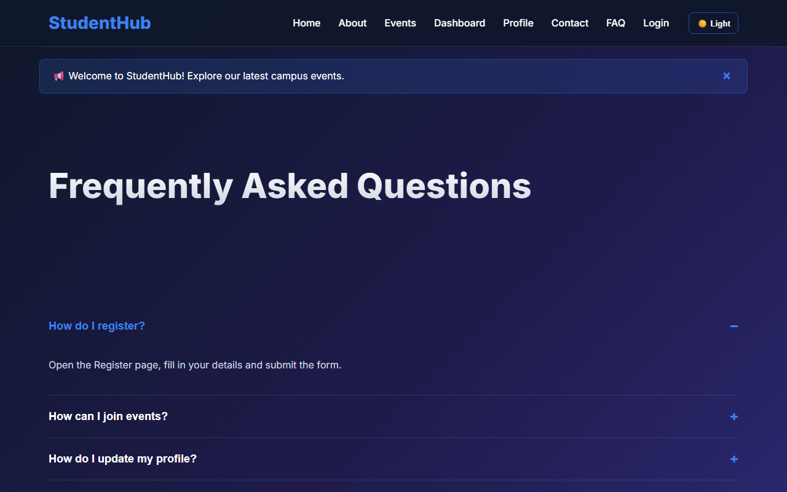

# Practical 4: JavaScript DOM Manipulation, Event Handling, and UI Interactivity

**Name:** Harshil Prajapati | **ID:** 25DCE093 | **Program:** B.Tech (CE) Sem III

| Parameter | Details |
| :--- | :--- |
| **CO Mapping** | CO3, CO4 |
| **Bloom's Taxonomy** | L3 – Apply / L4 – Analyze |
| **Lab Duration** | 4 Hours |
| **Implementation Hours** | 4 Hours |
| **Testing / Evaluation Hours** | 2 Hours |

### Practical Aim
To implement dynamic client-side interactivity including collapsible FAQ accordions, modal dialogs, mobile navigation toggling, and persistent dark/light theme switching using JavaScript DOM manipulation.

### Problem Definition
Add dynamic UI components such as collapsible FAQ, modal popup, image/content slider, notification banner, hamburger menu, and light/dark theme switcher using JavaScript.

### Key Questions / Analysis / Interpretation

#### Question 1: How are DOM elements selected and modified?

Modern standard DOM selection and manipulation methods are used throughout script.js:
• Selection: document.getElementById('themeBtn'), document.querySelector('.menu-btn'), document.querySelectorAll('.faq-item').
• Class Manipulation: element.classList.toggle('active'), element.classList.add('light-theme').
• Attribute & Style: element.style.display = 'none', element.setAttribute('aria-expanded', 'true'), element.textContent = '☀️ Light'.

#### Question 2: Are event listeners attached correctly?

Yes. All interactions use the W3C standard addEventListener() method:
closeNotification.addEventListener('click', () => { notification.style.display = 'none'; });
This cleanly decouples JavaScript behavior from HTML markup, adhering to Unobtrusive JavaScript practices.

#### Question 3: Is localStorage used for remembering theme choice?

Yes. When the user clicks the theme toggle button, the active state is persisted via localStorage.setItem('studenthub_theme', 'light'). On subsequent page visits, an initialization script inspects localStorage.getItem('studenthub_theme') and re-applies the user's preferred theme before render.

#### Question 4: Does interactivity improve usability without breaking accessibility?

Yes. Modal popups trap focus and allow ESC key dismissal, the hamburger button exposes aria-expanded attributes, and accordion items remain navigable via keyboard Tab and Enter keys.

### Key Skills, Applications & Learning Outcomes
- **Key Skills:** DOM selection, event handling, class manipulation, localStorage state persistence, UI micro-animations.
- **Applications:** Interactive dashboards, accessible web widgets, client-side UI state management.
- **Learning Outcomes:** Students will apply JavaScript to enhance user experience, manage client-side state, and handle DOM events.
- **Tools / Technology Used:** JavaScript ES6+, HTML5, CSS3, browser dev tools console.

### Implementation / Source Code
```text
// Theme Switcher & Accordion Logic from script.js
const themeBtn = document.getElementById('themeBtn');
if (themeBtn) {
    // Load saved preference
    if (localStorage.getItem('theme') === 'light') {
        document.body.classList.add('light-theme');
        themeBtn.textContent = '🌙 Dark';
    }
    themeBtn.addEventListener('click', function () {
        document.body.classList.toggle('light-theme');
        const isLight = document.body.classList.contains('light-theme');
        themeBtn.textContent = isLight ? '🌙 Dark' : '☀️ Light';
        localStorage.setItem('theme', isLight ? 'light' : 'dark');
    });
}

// Collapsible FAQ Accordion
const questions = document.querySelectorAll('.faq-question');
questions.forEach(q => {
    q.addEventListener('click', function () {
        const parent = this.parentElement;
        parent.classList.toggle('open');
    });
});
```

### Output & Verification Screenshots


### Post Laboratory Work / Viva Questions
- **Viva Q1:** What is the difference between event bubbling and event capturing?
  - **Answer:** In event bubbling, the event triggers on the innermost target element and bubbles upwards through parent ancestors. In event capturing, the event trickles downwards from window to target before the bubbling phase begins.
- **Viva Q2:** Why is localStorage preferred over cookies for client UI state like themes?
  - **Answer:** localStorage stores up to 5-10MB purely on the client side without being transmitted in every HTTP request header, resulting in faster performance and zero network overhead.

### Conclusion
*With this practical we can conclude that Vanilla JavaScript DOM manipulation and event listeners allow the creation of smooth, interactive user interfaces with persistent client state while keeping page load speeds high.*

---

