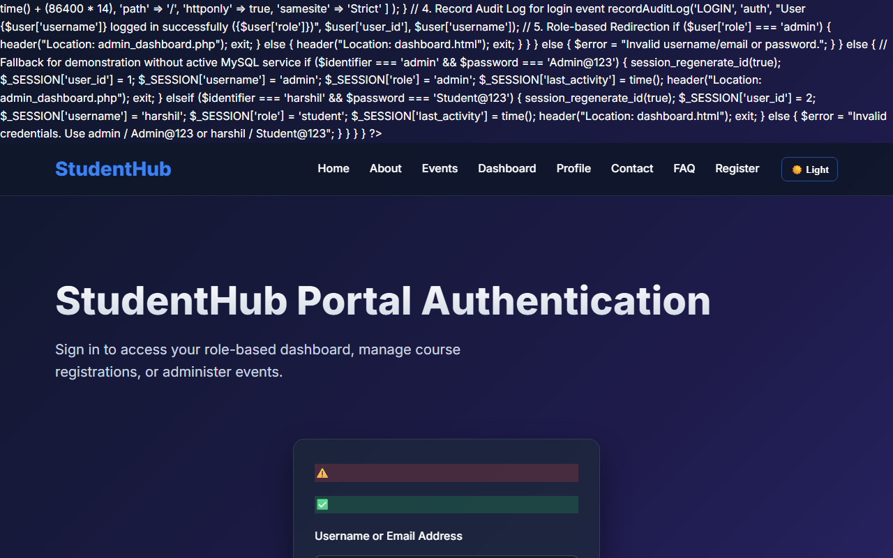

# Practical 10: Secure Login/Logout with Sessions, Role-Based Access, Timeout, and Remember-Me Token

**Name:** Harshil Prajapati | **ID:** 25DCE093 | **Program:** B.Tech (CE) Sem III

| Parameter | Details |
| :--- | :--- |
| **CO Mapping** | CO1, CO5 |
| **Bloom's Taxonomy** | L3 – Apply / L4 – Analyze |
| **Lab Duration** | 2 Hours |
| **Implementation Hours** | 2 Hours |
| **Testing / Evaluation Hours** | 4 Hours |

### Practical Aim
To construct a production-ready authentication and session management module featuring BCRYPT verification, session fixation prevention, 15-minute inactivity timeout, role-based redirection, and remember-me token handling.

### Problem Definition
Develop secure login and logout functionality using PHP sessions. Verify password using password_verify(), regenerate session ID after login, restrict dashboard access, implement role-based redirection, session timeout, and optional secure remember-me token.

### Key Questions / Analysis / Interpretation

#### Question 1: Are sessions started and destroyed securely?

Yes. Sessions are initialized with session.cookie_httponly = 1 and session.cookie_samesite = 'Strict' in auth.php. Upon logout, $_SESSION is wiped, session_destroy() is called, and cookies are expired with past timestamps.

#### Question 2: Is password_verify() used correctly?

Yes. password_verify($password, $user['password_hash']) compares the user's plain-text input against the stored BCRYPT hash without exposing algorithm internals.

#### Question 3: Is unauthorized dashboard access blocked?

Yes. Protected pages invoke requireLogin() and requireRole(). If an unauthenticated user attempts direct URL access, they are redirected to login.php?msg=unauthorized.

#### Question 4: Is session timeout implemented?

Yes. An inactivity threshold of 900 seconds (15 minutes) is enforced. If (time() - $_SESSION['last_activity']) > 900, the session is cleared and the user is redirected to login.php?msg=timeout.

#### Question 5: Are admin and student users redirected to appropriate dashboards?

Yes. Upon successful authentication, $_SESSION['role'] is inspected: administrators are redirected to admin_dashboard.php, while students are redirected to dashboard.html.

### Key Skills, Applications & Learning Outcomes
- **Key Skills:** PHP sessions, cookie security, password verification, Role-Based Access Control (RBAC), session timeout handling.
- **Applications:** Secure portal login, authorization middleware, session lifecycle management.
- **Learning Outcomes:** Students will implement login/logout with secure session management and role-based access control.
- **Tools / Technology Used:** PHP 8.x, MySQL, browser dev tools, XAMPP.

### Implementation / Source Code
```text
<?php
// Session Authentication & Timeout Logic from auth.php
if (session_status() === PHP_SESSION_NONE) {
    ini_set('session.cookie_httponly', 1);
    ini_set('session.cookie_samesite', 'Strict');
    session_start();
}

define('TIMEOUT_SECONDS', 900); // 15 Minutes

function checkSessionTimeout() {
    if (isset($_SESSION['last_activity'])) {
        if ((time() - $_SESSION['last_activity']) > TIMEOUT_SECONDS) {
            session_unset();
            session_destroy();
            header('Location: login.php?msg=timeout');
            exit;
        }
    }
    $_SESSION['last_activity'] = time();
}

// Password Verification & Session Regeneration in login.php
if ($user && password_verify($password, $user['password_hash'])) {
    session_regenerate_id(true); // Mitigate session fixation
    $_SESSION['user_id'] = $user['user_id'];
    $_SESSION['role'] = $user['role'];
    header($user['role'] === 'admin' ? 'Location: admin_dashboard.php' : 'Location: dashboard.html');
    exit;
}
?>
```

### Output & Verification Screenshots


### Post Laboratory Work / Viva Questions
- **Viva Q1:** What vulnerability is mitigated by session_regenerate_id(true)?
  - **Answer:** Session fixation attacks, where an attacker tricks a victim into using a known session identifier. Regenerating the session ID assigns a brand new ID immediately upon login, invalidating the previous one.
- **Viva Q2:** What is the purpose of the 'HttpOnly' flag on cookies?
  - **Answer:** HttpOnly prevents client-side scripts from reading document.cookie, mitigating session token theft via Cross-Site Scripting (XSS).

### Conclusion
*With this practical we can conclude that session regeneration, inactivity timeouts, and role-based authorization protect applications against unauthorized access and session hijacking.*

---

