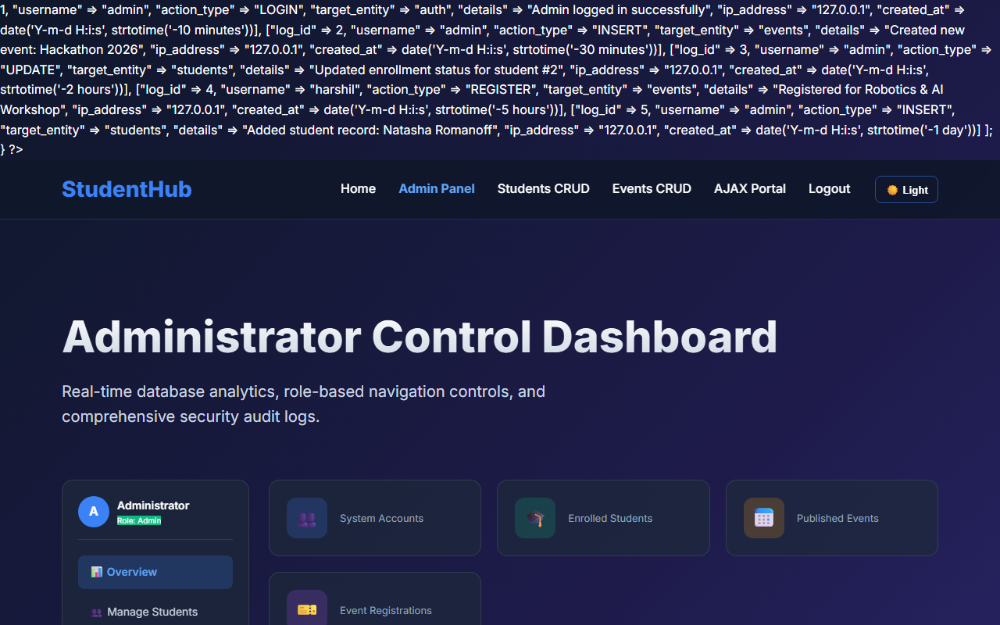

# Practical 14: Admin Dashboard with Role-Based Access Control, Dynamic Menu, and Audit Log

**Name:** Harshil Prajapati | **ID:** 25DCE093 | **Program:** B.Tech (CE) Sem III

| Parameter | Details |
| :--- | :--- |
| **CO Mapping** | CO1, CO4, CO5 |
| **Bloom's Taxonomy** | L3 – Apply / L4 – Analyze |
| **Lab Duration** | 4 Hours |
| **Implementation Hours** | 4 Hours |
| **Testing / Evaluation Hours** | 2 Hours |

### Practical Aim
To construct an Administrator Control Dashboard featuring dynamic SQL aggregation metrics, visual participation analytics, role-based navigation menus, and security audit log tracking.

### Problem Definition
Develop an admin dashboard that displays user statistics, student count, event count and latest registrations. Restrict access to admin users only and show dynamic menu options based on role. Record actions in audit_logs.

### Key Questions / Analysis / Interpretation

#### Question 1: Are dashboard values loaded dynamically from the database?

Yes. Live SQL aggregation queries (SELECT COUNT(*) FROM ...) compute system accounts, enrolled students, active campus events, and total event registrations directly from the database.

#### Question 2: Is access restricted to admin users?

Yes. The page executes requireRole('admin') at the start. Any unauthenticated or non-admin visitor is redirected away with an authorization warning.

#### Question 3: Are role-based menus working?

Yes. The navigation sidebar renders administrative management options (Manage Students, Manage Events, Audit Logs) exclusively for administrators.

#### Question 4: Are important admin actions recorded in audit_logs?

Yes. Every critical operation (INSERT, UPDATE, DELETE, LOGIN) invokes recordAuditLog(), persisting the timestamp, administrator username, action type, affected table, client IP address, and details into the audit_logs table.

### Key Skills, Applications & Learning Outcomes
- **Key Skills:** Dashboard architecture, Role-Based Access Control (RBAC), SQL aggregation queries, security audit logging, dynamic role-based UI loading.
- **Applications:** System administration panels, security compliance monitors, university management cockpits.
- **Learning Outcomes:** Students will build a role-based admin dashboard with real-time monitoring and security traceability.
- **Tools / Technology Used:** PHP 8.x, MySQL, CSS Grid, Charting visualization.

### Implementation / Source Code
```text
<?php
// SQL Metrics Aggregation & Audit Logging from admin_dashboard.php
require_once 'auth.php';
requireRole('admin'); // Enforce strict RBAC

// Dynamic Metric Counts
$userCount    = mysqli_fetch_assoc(mysqli_query($conn, "SELECT COUNT(*) as c FROM users"))['c'];
$studentCount = mysqli_fetch_assoc(mysqli_query($conn, "SELECT COUNT(*) as c FROM students WHERE status != 'deleted'"))['c'];
$eventCount   = mysqli_fetch_assoc(mysqli_query($conn, "SELECT COUNT(*) as c FROM events"))['c'];
$regCount     = mysqli_fetch_assoc(mysqli_query($conn, "SELECT COUNT(*) as c FROM registrations"))['c'];

// Query Recent Security Audit Logs
$auditLogs = mysqli_query($conn, "SELECT * FROM audit_logs ORDER BY log_id DESC LIMIT 10");
?>
```

### Output & Verification Screenshots


### Post Laboratory Work / Viva Questions
- **Viva Q1:** Why is audit logging essential for administrative portals?
  - **Answer:** Audit logs maintain a tamper-evident chronological record of all system operations, allowing security forensics, accountability, and traceability for regulatory compliance.
- **Viva Q2:** How do SQL aggregation queries like COUNT(*) and GROUP BY optimize dashboard performance?
  - **Answer:** They execute set-based summarization directly inside the database engine, returning a single computed scalar value to PHP rather than transferring millions of raw row bytes across the network.

### Conclusion
*With this practical we can conclude that role-based access control, dynamic SQL metric aggregations, and immutable audit logs provide administrators with real-time oversight and full traceability.*

---

